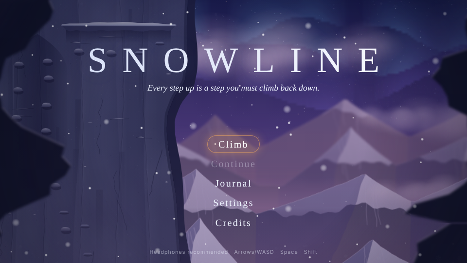
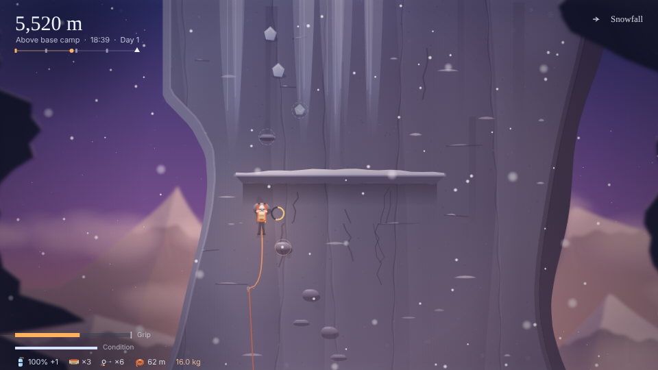
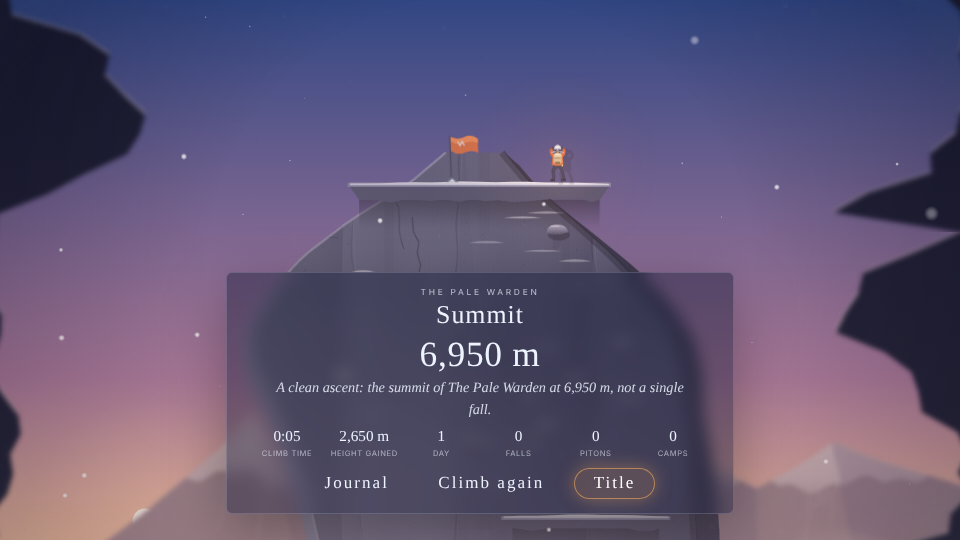

# Snowline

A 2.5D procedural mountain-climbing game about one decision: keep going, or turn back.

You climb a seeded mountain in side view, managing grip, rope, food, oxygen and pack weight against weather that changes the climb. Each climb ends in a summit, a retreat, or a fall. Everything is painted with Canvas 2D and scored live with Web Audio. There is no build step, no framework, no WebGL and no bundled audio.





## Controls

| Action | Keyboard | Gamepad | Touch |
|---|---|---|---|
| Move / reach toward a hold | Arrows or WASD | Left stick / D-pad | D-pad |
| Lunge (with a direction), then catch | Space, then Space again as the ring closes | A | Lunge |
| Grip: brace in wind and avalanches, catch a lunge, grab a hold while falling | Left Shift or K (hold) | B / RT | Grip |
| Place piton (anchors your rope) | E | X | Piton |
| Eat | Q | Y | Eat |
| Swap oxygen bottle | R | RB | O₂ |
| Pack (drop gear) | Tab or I | Select | Pack |
| Pause | Esc or P | Start | II |
| Rest on the rope (next to your last piton) / make camp | Down | Down | ▼ |

Every key can be remapped under **Settings → Controls**. Menus work with mouse, keyboard (arrows, Enter, Esc), gamepad and touch.

### How to climb

- **Holds within reach** are softly ringed. Dashed rings are only reachable with a **lunge**. Lunges cost more grip, and you must press Space or Grip again inside the catch window (the ring brightens) or you fall.
- **Grip** drains while you hang. Crimps, ice, overhangs, snow-loaded holds, wind, weight and thin air all drain it faster. It recovers on ledges, and slowly while you hang on the rope. Spending grip lowers your ceiling (the tick mark on the bar). Food and camps restore it.
- **Rope and pitons.** Your rope runs from the last anchor. A fall is caught when you drop past the rope's length below that anchor, so a climber 10 m above a piton falls about 20 m. Beyond 70 m of run-out the rope can't protect you. Pitons are limited, so they're also your mid-face rest points.
- **Thin ice** cracks while you hold it, and **snow bridges** on ledges give way if you stand on them. Both are telegraphed by sound and visible cracks. Hop a snow bridge with Space and a direction. If one collapses, hold Grip to catch the lip.
- **Rockfall** is marked at the top of the screen and heralded by clattering stones. Move aside, or brace under an overhang. **Avalanches** rumble before they hit: brace or get under cover.
- **Oxygen** drains above the peak's oxygen line. Swap bottles with R. Run dry and hypoxia sets in: slower recovery, a narrowing view, and eventually collapse.
- **Camps** are checkpoints. Rest, sleep through the night, take or leave supplies, then choose to keep climbing or descend. Continuing a saved climb resumes from the last camp.
- **Turn back?** prompts appear when oxygen, health, food or a coming storm makes the summit doubtful. Retreating is a real ending and goes in the journal.

Difficulty (**Gentle / Standard / Harsh**) scales grip drain, weather severity, fall damage, hazard rate, the catch window, starting gear and camp supplies. Gentle routes never require a lunge.

## Running locally

There is no build step: `index.html` is the whole game. Browsers block ES modules on `file://` URLs, so serve the folder over HTTP (or use GitHub Pages, below). From the repository root, any static server will do:

```sh
python3 -m http.server 8080      # or: npm run serve
# then open http://localhost:8080
```

```sh
npx serve .                      # alternative, if you have Node
```

Run the tests (Node 18+, no dependencies):

```sh
npm test
```

## Deploying to GitHub Pages

1. Push the repository to GitHub.
2. Go to **Settings → Pages**, set **Source** to *Deploy from a branch*, choose the branch (for example `main`) and the `/ (root)` folder, and save.
3. After a minute the game is live at `https://<user>.github.io/<repo>/`. All paths are relative, so it works from a sub-path with no configuration.

## Project structure

```
index.html            stage, canvases and DOM overlay root
css/style.css         letterboxed 16:9 stage, frosted menus, focus states, touch controls
js/main.js            bootstrap, fixed-step loop wiring, scene flow, event → audio/visual mapping
js/storage.js         settings, journal, bests and camp checkpoint (localStorage with memory fallback)
js/engine/            loop, input (keys/pad/touch, remappable), assets, audio graph + procedural reverb,
                      tween/easing, particles, camera, seeded rng/noise, math
js/render/            palette + time-of-day, sky (stars, aurora, sun/moon), parallax planes and clouds,
                      cached wall chunks, props (camp, rope, climber), lighting, weather fx, post fx
js/music/             theory, phrase generator, mixer (pure), instruments, stems, score, stingers,
                      ambience (wind bands), sfx
js/game/              constants, peaks, terrain generation, altitude, stamina, rope, resources,
                      weather, hazards, player state machine, climb session, climb state rules
js/ui/                screen manager, title/credits, peak select, settings, journal, overlays
                      (pause, camp, turn-back, pack), end screens, HUD, captions, touch, transitions
test/                 node:test suites for the pure logic, plus a route-following bot
assets/sprites/       hand-written SVG sprites (climber poses, axe, rope, tent, flags, piton, icons)
docs/                 plan and screenshots
```

### Rendering in brief

The frame is a stack of depth planes, back to front:

1. Sky gradient, stars, aurora and sun or moon.
2. Four parallax mountain planes, from far to near and from pale to dark and blurred to sharp.
3. Clouds and fog bands between the planes.
4. The play plane: the climbing wall, the climber, rope and camps.
5. Dark foreground overhangs.
6. Three bands of snow.
7. Whiteout, haze, frost, vignette and the HUD.

Mountain planes and wall sections are baked into offscreen canvases. They are re-baked only when the time-of-day bucket, palette or quality changes, so blur and gradients cost nothing per frame. The play plane is drawn to its own canvas so the ambient grade and the lantern's light pool apply only to the rock.

## How the music works

The score is generated live, with no samples.

- **Key and harmony.** Each peak has a root and a mode: Kestrel Spire is D Dorian, the Pale Warden is A Aeolian, Hollowhorn is E Phrygian, and the daily peak is seeded. A slow harmonic clock walks a modal progression, one chord every eight beats. At each new camp the key rises a whole step, so the music climbs with you.
- **Stems**, crossfaded continuously:
  - **Drone**: four pad voices of detuned saws and triangles through low-pass filters with slow LFOs. Altitude opens the filters and fades in an upper-octave voice.
  - **Melody**: phrases from a seeded generator. They move mostly by step with occasional leaps and rests, land on a chord tone, and sometimes restate an earlier motif transposed. They are played on an FM bell or a soft felt piano with long reverb tails.
  - **Pulse**: a low lub-dub heartbeat that fades in and quickens as grip runs out or danger rises.
  - **Storm**: band-passed pink noise sweeps, a sub-bass rumble, and dissonant swells a semitone apart, scaled by weather intensity.
  - **Warmth**: a soft major pad and a plucked arpeggio at camp. The summit brings in everything with a Picardy (major) resolution.
- **Mixer.** `js/music/mixer.js` is a pure function. It maps scene, altitude, stamina, danger, storm, night and hypoxia to stem levels, brightness, tension and tempo. Tests cover it.
- **Reverb.** One convolution reverb with a procedurally generated stereo impulse: pre-delay, sparse early reflections, and a 4.6 s tail that darkens over time for a cold, cavernous space.
- **Stingers** for falls, the summit, anchors, rope tension, near misses, forecasts and endings. They are composed from scale degrees, so they always sit in the current key.
- **Sound effects** are synthesised too: wind bands and a resonant howl that follow gusts, snow, rock and ice footsteps, pick and piton strikes whose pitch rises as the piton seats, rope creaks, breathing tied to exertion and oxygen, fall whooshes and impacts, ice cracks, rockfall, avalanche rumbles, birds and a crackling fire.
- **Buses.** Music, ambience, SFX and UI each have their own bus and volume, then pass through a master compressor. Audio starts on the first click, key or tap.

## Accessibility

Settings include:

- Reduced motion: no shake or tilt, shorter transitions, and a calmer camera.
- Colour-safe mode: hazards and meters use shapes and hatching on a yellow and blue scheme.
- Subtitles for sound cues, for example `[stones clatter above]` and `[ice cracks]`.
- Full key remapping.
- Visual quality presets that change resolution, blur, particle count and layer count.
- An FPS counter.
- Toggleable hold highlights.

Every setting applies immediately and persists. The game pauses automatically when the window loses focus.

## License

MIT.
